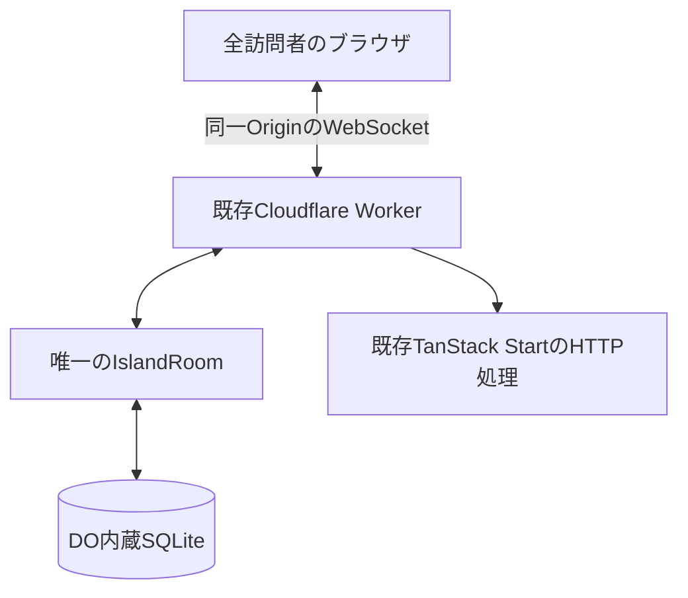

# トップページの島の共同編集仕様

作成日：2026-11-11。
調査時のコミット：`09310c6`。
この文書は、別セッションで実装を開始するための仕様書である。
この文書の作成時点では、共同編集機能は未実装である。
実装開始時には `AGENTS.md` と実際のソースを再確認し、ユーザーによる後続の変更を優先する。

## 1. 目的と確定した要件

トップページに存在する唯一の島を、不特定多数の訪問者が同時に編集する。
誰かが変更した地形や装飾は全員に反映され、全員が退出した後も残る。
ブラウザが保持する島は描画用のコピーであり、正本はサーバーにひとつだけ置く。

ユーザーが指定した要件は次のとおり。

- 個人の編集残量は最大30マス分とし、60秒につき1マス分回復する。
- 島全体の編集上限は、無料枠で処理できる量の半分を基準に計算する。
- 接続ごとにメッセージの送信頻度とサイズを制限し、連打する接続を切断する。
- 編集履歴を保持しない。

以下は、会話で提案した内容や実装上必要な判断を具体化した初期仕様である。
ユーザーが明示した数値と、調整可能な初期値を区別する。
本書の範囲内の実装は進められるが、料金プラン変更や本番への公開は別の操作である。

| 項目 | 採用する初期仕様 | 根拠 |
| --- | --- | --- |
| 共有状態の管理 | Cloudflare Durable ObjectsとWebSocket | 既存のCloudflare Workers構成に追加する |
| 島の数 | 本番環境に1個 | ユーザーの明示要件 |
| 個人の初期残量 | 30 | 最大残量から開始する初期仕様 |
| 個人の最大残量 | 30 | ユーザーの明示要件 |
| 個人の回復間隔 | 60,000ms | ユーザーの明示要件 |
| 島全体の編集上限 | 暫定16,000マス／UTC日 | 第4節の書き込み行数による計算 |
| 個人の識別 | サーバー発行の署名付き匿名Cookie | ログイン機能を追加しない初期仕様 |
| 編集の送信タイミング | ドラッグ終了時、またはキーボード操作の確定時 | 未確定操作のキャンセルを成立させる |
| 他人のカーソル表示 | 初期実装には含めない | 継続的な通知を減らすための初期仕様 |
| 再接続 | 最新の島全体を取得 | 履歴を持たない要件に対応する |

初期実装には、複数の島、島の作成機能、個人用の島、CRDT、オフライン編集、編集履歴、Undo/Redo、過去への復元、公開リセットAPI、住人の動作同期を含めない。
住人に対応するブログ記事の追加や既存記事の変更も、この実装には含めない。

## 2. 開発環境と既存コード

### 2.1 実行環境

- TanStack StartとReact、Three.js、TypeScript、Viteで構成されている。
- Cloudflare Workersのエントリーは `src/server.ts`。
- `wrangler.jsonc` の本番Worker名は `tlazolteotnia`、ドメインは `0rga.org`。
- D1の `DB` bindingは既存のリアクション機能で使用している。
- `REACTION_RATE_LIMITER` と `REACTION_COOKIE_SECRET` もリアクション専用である。
- 島用のDurable ObjectやWebSocket APIはまだ存在しない。
- Node.jsの対応範囲は `package.json` の `engines` に従う。
- 開発環境は通常 `http://localhost:3000/`。

`AGENTS.md` により、ブラウザ確認には必ず `playwright-cli` を使う。
開発環境に接続できなければユーザーに起動を依頼し、別ポートで勝手に起動しない。
ソース調査では `dist/`、`build/` などの生成物を検索対象にしない。
この文書の作成時には、既存の開発環境でトップページと島クリエイトのツール表示を確認した。

### 2.2 先に読むファイル

| ファイル | 現在の役割と実装時の変更点 |
| --- | --- |
| `src/routes/_town.tsx` | 記事情報を取得し、`ArticleTown` を維持するレイアウト |
| `src/routes/_town.index.tsx` | トップページのメタデータ |
| `src/components/article-town.tsx` | 編集UI、入力、カメラ、記事モーダルの接続 |
| `src/components/use-island.ts` | 島の初期化、`localStorage`への保存、編集ストローク、レンダラーの管理 |
| `src/components/island-toolbar.tsx` | 土地、削除、装飾、撤去、移動のツール表示 |
| `src/lib/island-world.ts` | 島のデータ構造、初期島、保存形式、地形と装飾のルール |
| `src/lib/island-edit.ts` | `planTileEdit`、`planBrush`、`tilesAlong`、`createIslandStroke` |
| `src/lib/island-input.ts` | ポインター、ピンチ、キャンセル、住人のドラッグ |
| `src/lib/island-three.client.ts` | Three.js描画、`updateTiles`、住人の占有判定 |
| `src/lib/island-residents.ts` | 住人の生成、歩行、`settleResidents` |
| `src/lib/island-camera.ts` | カメラと画面内のセッション状態 |
| `src/components/town-loading.tsx` | 既存のロード中表示 |
| `src/lib/security-headers.tsx` | CSPなどのHTTPヘッダー |
| `src/lib/reaction-api.server.ts` | Origin確認とIP単位の制限の既存例 |
| `tests/island.test.ts` | 島、保存形式、編集、住人の既存テスト |
| `tests/island-input.test.ts` | 入力とキャンセルの既存テスト |
| `tests/router-csp.test.ts` | CSPとルーターの検証 |

### 2.3 現在の島の構造

`IslandWorld` は `columns`、`rows`、`ground: Uint8Array`、`decor: Uint8Array` を持つ。
島は80列×60行で、インデックスは `y * 80 + x`。
外周2マスは編集対象外なので、編集範囲は `2 <= x < 78`、`2 <= y < 58` である。
各マスは地形を1個、装飾を最大1個持つ。

地形は海と、`groundGroups` に並ぶ土地21種類（草、砂と土、岩、道、水の5系統）の計22種類。
種類と番号は `island-world.ts` の定数を正とし、新しい地形は末尾に追加する。
装飾の種類と配置条件は `decorInfo`、`decorFits`、`decorBlocksWalking` を正とする。
現行保存形式は `ISLAND_SAVE_VERSION = 3` で、`serializeIsland` が圧縮したJSONを生成する。
`parseIsland` は旧version 2の移行や一部の正規化も行うため、ネットワーク入力の検証器として無条件に流用しない。

現在の保存先は `localStorage['tlazolteotnia:island']`。
ドラッグ中は `world` 自体を書き換え、キャンセル時に元の値を書き戻している。
共同編集では、この書き戻しが他人の更新を消すため、第10節の構造に変更する。

## 3. サーバー構成と状態の所有者



Durable Objectのクラス名は `IslandRoom`、binding名は `ISLAND_ROOM`、固定の名前は `public-island` とする。
HTTPリクエストやクライアント入力から任意の島IDを選択させない。
すべての公開島APIは、同じ名前から取得したDO stubへ転送する。
ローカル開発、プレビュー、本番ではbindingの保存領域を分離し、開発環境から本番DOに接続しない。

WebSocketはHibernation APIを使う。
`acceptWebSocket`、`webSocketMessage`、`webSocketClose`、`webSocketError` を使い、必要な接続情報をattachmentに保持する。
休止や再起動で消えるメモリを、残量や日次上限の唯一の保存先にしない。
永続化と確定通知の順序は、Cloudflareのストレージ保証を使って検証する。

| 状態 | 所有者 | 永続化 |
| --- | --- | --- |
| 島の地形と装飾、島の更新番号 | DO | 必須 |
| 個人の残量、回復基準時刻、個人の更新番号 | DO | 必須 |
| 全体の日次編集数と管理用カウンター | DO | 必須 |
| 接続ごとの通信制限 | DOのWebSocket attachment | 接続の休止復帰を越えて維持 |
| カメラ、ズーム、選択ツール、開いている記事 | ブラウザ | 既存のローカル状態 |
| 編集中と送信待ちのプレビュー | ブラウザ | 保存しない |
| 住人の歩行、住人をつかむ操作、水面の演出 | ブラウザ | 共有しない |

D1へ島の状態を二重保存しない。
R2、Queues、別のWebSocketサーバー、常駐のゲームループは追加しない。

## 4. 無料枠と島全体の上限

### 4.1 書き込み行数から求める初期値

2026-11-11確認時点のWorkers FreeにおけるSQLite-backed DOの書き込み枠は100,000行／日である。
目標をその半分の50,000行／日とする。
Paidプランの月間込み枠とは区別する。
料金表：[Durable Objects Pricing](https://developers.cloudflare.com/durable-objects/platform/pricing/)。

第7節の保存構造で、確定する1バッチは最新の島、編集者、全体カウンターの3行を書き込む。
1バッチが1マスだけの場合を、マス数あたりの書き込みが最大になるケースとして計算する。

```text
書き込み予算 = 100,000 × 0.5 = 50,000行／日
編集可能数の計算値 = floor(50,000 ÷ 3) = 16,666マス／日
初期設定 = 16,000マス／日
編集による最大書き込み想定 = 16,000 × 3 = 48,000行／日
管理処理に残す予算 = 2,000行／日
```

同じマスを後から再変更した場合も、その都度1マスとして数える。
1回のリクエスト内の重複インデックスで消費数を操作できないようにする。
拒否や変更なしの操作では、島、個人、日次カウンターのいずれも書き込まない。

16,000という値は、1確定につき課金上の書き込みが3行以内になることを条件とする。
実装では `SqlStorageCursor.rowsWritten` で確認し、インデックス、初期化、期限切れデータの削除、アラーム設定を含めて予算を検証する。
3行を超える場合は、保存構造を修正するか、`floor(48,000 / 実測の最悪書き込み行数)` 以下に日次マス上限を下げる。
16,000を優先して無料枠の計算を無視しない。
行数計測：[SQLite Storage API](https://developers.cloudflare.com/durable-objects/api/sqlite-storage-api/)。

### 4.2 個人の利用量との関係

満タンから10分間利用する場合の編集可能数は、端点を含む概算で `30 + 600 / 60 = 40マス`。
100人なら約4,000マス／日で、単独マスの送信だけでも約12,000行／日の編集書き込みになる。
これは利用例であり、人数自体に100人という制約を設けるものではない。

### 4.3 書き込み以外の枠

「書き込みを半分に抑えること」と「すべての料金項目を半分以内に保証すること」を区別する。
DOにはリクエスト、稼働時間、読み取り、保存容量にも別の枠がある。
Worker自体のHTTPリクエストにも別の枠があり、既存サイトの利用も考慮する。

| 項目 | Freeの枠 | 半分の目標値 |
| --- | --- | --- |
| DOのリクエスト | 100,000／日 | 50,000／日 |
| DOの稼働時間 | 13,000 GB秒／日 | 6,500 GB秒／日 |
| DOのSQL読み取り | 5,000,000行／日 | 2,500,000行／日 |
| DOのSQL書き込み | 100,000行／日 | 50,000行／日 |
| DOの保存容量 | 5GB | 2.5GB |
| WorkerのHTTPリクエスト | 100,000／日 | 50,000／日 |

DOのWebSocket受信は課金換算で20メッセージにつき1リクエスト、接続開始は1リクエストとして扱われる。
単一DOでも、終日稼働すると半分の稼働時間目標を超え得るため、Hibernationを有効にする。
拒否メッセージや閲覧者の接続でも処理は発生するため、編集マス上限だけで総費用の上限を保証しない。
書き込み以外の値は監視目標とし、初期実装の負荷試験結果を残す。
リクエスト本文や全編集イベントを常時ログ出力しない。

Freeでは制限超過後の該当処理が失敗する。
すでにPaidを契約している場合、少量利用でも基本料金はなくならない。
現在の契約プランはこの調査では確認していないので、実装前に決めつけたり変更したりしない。
参考：[Workers Pricing](https://developers.cloudflare.com/workers/platform/pricing/)。

## 5. 個人の残量と匿名識別

### 5.1 Cookie

初期実装の「個人」は、同じ署名付きCookieを使うブラウザを指す。
人間一人を厳密に識別する仕組みではなく、Cookie削除や別ブラウザによる再取得は防ぎきれない。
全体上限は、この匿名識別の限界とは独立してDOが保証する。

- 専用の `ISLAND_COOKIE_SECRET` を追加し、既存リアクションの秘密情報を流用しない。
- Cookieの内容はランダムな256bit ID、発行時刻、有効期限、バージョンとHMAC署名。
- 本番の名前は `__Host-island_visitor`、`HttpOnly; Secure; SameSite=Lax; Path=/`。
- HTTPのローカル開発だけは `island_visitor_dev` を使い、Secureを省く。
- 有効期間は発行から30日間とし、有効なCookieを読み込んだだけでは期限を延長しない。
- Cookieに残量、使用済みマス数、編集権限を持たせない。
- 署名、有効期限、形式をサーバーで検証し、外部入力の任意IDを採用しない。
- 秘密情報が未設定ならセッション発行と編集を503で停止し、既存記事の表示を維持する。

Cookieの発行ではDOの個人行を作らない。
個人行は、そのIDが最初に編集を確定するときに作る。
同じCookieの複数タブは同じ残量と個人更新番号を使う。
開いたままのWebSocketでも、各編集要求でattachmentの有効期限を確認する。
期限切れなら4001で閉じ、セッションを取得し直すまで編集を許可しない。

### 5.2 回復計算

個人行は `tokens` と `refillBaseMs` を保持し、回復判定にはサーバー時刻を使う。
毎分全員の残量を書き換えるタイマーやジョブは作らない。
読み取り時の回復計算だけでは書き込まず、次の編集確定時に計算結果を保存する。

```text
tokensが30のとき:
  available = 30
  base = now
それ以外:
  elapsed = max(0, now - refillBaseMs)
  recovered = floor(elapsed / 60,000)
  available = min(30, tokens + recovered)
  base = available == 30 ? now : refillBaseMs + recovered × 60,000

changedCount <= available なら:
  tokens = available - changedCount
  refillBaseMs = base
```

満タン時に蓄積していた待ち時間を、消費直後の即時回復に使わせない。
満タンで1マス消費した場合は、その確定時刻から60秒後に次の1マスが回復する。
残量不足ならバッチ全体を拒否し、島も残量も更新しない。
クライアントの秒表示は推定値であり、編集可否は必ずサーバーで再判定する。

## 6. 編集ルール

操作は `land`、`erase`、`decor`、`remove` の4種類を維持する。
クライアントはツールの意図と対象インデックスを送り、完成後の島全体や任意の `TileEdit` を書き込ませない。
サーバーは、確定済みの最新状態に対して `planTileEdit` 相当の共通ルールを実行する。

- `land`：指定した陸地へ変更する。
- `erase`：海へ変更し、そのマスの装飾も取り除く。
- `decor`：配置条件を満たす空きマスへ装飾を置く。
- `remove`：既存の装飾を取り除く。
- 同じ状態への変更はno-opとして消費しない。
- 地形と装飾が同時に変わっても、1マスの確定変更として1消費とする。
- 既存装飾を別の装飾に上書きする操作は認めず、既存ルールどおり撤去を必要とする。
- 配置結果が `decorFits` に違反しないことを、サーバーでも確認する。

入力形式の不正、範囲外のインデックス、重複インデックス、未知のツールはバッチ全体を拒否する。
正しい入力のうち、配置できないマスやno-opはスキップし、その理由を返す。
残った有効な変更数が個人または全体の残量を超える場合は、有効分を含むバッチ全体を拒否する。
残量内なら有効な変更を一括で確定する。
有効な変更が0件なら永続化せず、結果だけ返す。

同じマスへの編集は、サーバーが確定した順に処理する。
古い全体更新番号を見ていた利用者の操作も最新の島に対して再評価し、無関係なマスの変更を理由にすべて拒否する方式にはしない。
同じ地形の塗り替えなら後に確定した結果が残り、装飾なら先に置かれた装飾を後続の配置条件が参照する。

### 6.1 住人との関係

住人は各ブラウザで独立して歩いているため、現在の `renderer.occupied()` を共有編集の可否判定には使わない。
クライアントのプレビューとサーバーの検証に、同じ固定の保護領域を使う。
初期仕様では中心 `(40, 30)` を含む3×3マスを避難用の保護領域とする。

初回生成時にこの9マスを歩行可能な草地かつ装飾なしへ正規化する。
以後、その領域を海にする操作と、歩行を妨げる装飾を置く操作を拒否する。
それ以外の地形の塗り替えや、歩行を妨げない花の配置は許可する。
この固定領域は共同編集を成立させるための初期仕様であり、ユーザーが直接指定した位置ではない。

確定差分の適用後は既存の `settleResidents` を利用し、障害物に埋まった住人を各ブラウザで移動させる。
既存の泳ぐ動作や住人のドラッグはローカルな演出として維持し、住人の座標をネットワークへ送らない。

## 7. SQLiteへの保存

編集イベントを蓄積するテーブルは作らない。
最低限の保存対象は次の3種類である。

| テーブル案 | 行数 | 保存する内容 |
| --- | --- | --- |
| `island_state` | 1 | 保存形式のバージョン、`serializeIsland` の結果、全体の `revision` |
| `island_actor` | 利用中の匿名ID分 | ID、残量、回復基準時刻、個人の `actorRevision`、Cookieの有効期限 |
| `island_control` | 1 | UTC日、当日の変更マス数、新規編集者数、個人行の総数、管理処理の予算と実行状況 |

各テーブルは適切な主キーを持ち、追加のインデックスを安易に増やさない。
テキスト主キーは `WITHOUT ROWID` なども検討し、課金上の行数を実測する。
島全体は小さいため、初期実装では現在の圧縮JSONを1行で更新する。
マスごとに4,800行を保存し、読み込みのたびに全件走査する構造は採用しない。

DOの起動時は、スキーマと最新状態を復元する。
初期島を作るのは `island_state` が未作成の初回だけとし、`createDefaultIsland` と保護領域の正規化を使う。
起動、再接続、記事追加、デプロイのたびに初期島で上書きしない。
保存データの破損や未知の保存バージョンでは、書き込みを停止してエラーを記録し、黙って初期島へ戻さない。
現行データの復号と、今後の保存形式の移行は明示的に分離する。

個人残量と日次マス数は、島の変更と同じSQLiteトランザクションで確定する。
同期SQL処理には `ctx.storage.transactionSync()` などの対応APIを使用する。
島のメモリ上の正本を先に変更せず、一時コピーで検証し、永続化成功後に差し替える。
途中の書き込み失敗では3種類の状態がすべて元に戻り、確定差分や成功応答を配信しない。
個人行の総数は作成と削除に合わせて同じcontrol行で更新し、新規編集のたびに全個人行を走査して数えない。
期限切れ行の走査も日次の掃除にまとめ、閲覧や編集のたびに実行しない。

### 7.1 個人データの保存期間と管理処理

「履歴なし」は過去の島や操作列を保存しないことを意味する。
残量制限と二重適用防止に必要な現在の個人状態は保存する。
Cookieの有効期限に合わせて個人行を削除し、再読み込みだけで残量が30に戻る実装を避ける。

無料枠の管理処理予算に収めるため、次の初期制限を設ける。
これらは実装上の推奨値であり、ユーザーが指定した値ではない。

- 新規の個人行を作成する編集は、島全体で1,000ID／UTC日まで。
- 同じIDのその後の編集には、この新規ID枠を再消費しない。
- 期限切れ行の削除は1日最大1,000行とし、削除自体も書き込みとして数える。
- 個人行の総数が32,000行に達したら、新しいIDの編集を停止し、既存IDと閲覧を維持する。
- 期限内の個人行は、枠を空けるために削除しない。
- 管理処理全体は1日2,000書き込み行以内とし、アラーム設定、カウンター更新、スキーマ初期化も含める。

日次アラームを使う場合は1日1回の掃除に限定し、休止を妨げる常駐タイマーは使わない。
アラームの再実行でも掃除予算を二重に使わないよう、当日の掃除済み件数を `island_control` に保持する。
日付変更と編集再開はアラームの成功に依存させず、リクエスト時のUTC日から判定する。
上限や行数の把握のためだけに、全編集のログを保存しない。

## 8. HTTPとWebSocketの通信仕様

### 8.1 エンドポイント

`src/server.ts` で、対象パスを既存TanStack Startハンドラーより前に処理する。
WebSocketの101応答を `new Response(response.body, ...)` で包み直さず、そのまま返す。
他のパスは既存ハンドラーとHTMLのセキュリティヘッダー処理へ流す。

| メソッドとパス | 用途 |
| --- | --- |
| `POST /api/island/session` | 匿名Cookieの検証または発行。本文は不要 |
| `GET /api/island/ws` | WebSocket Upgrade。Cookie検証後、固定DOへ転送 |
| `GET /api/island` | 最新の島と全体残量だけを返す閲覧用フォールバック |

通常はセッション取得後にWebSocketへ接続し、最初の `snapshot` で描画を開始する。
フォールバックGETは接続失敗時の閲覧用とし、定期ポーリングしない。
個人情報を含む応答は `Cache-Control: private, no-store` とする。
閲覧用GETも初期実装では `no-store` とし、CDNキャッシュは整合性を検証した後の拡張とする。
このGETは個人行を作らず、島の最新状態だけを取得する。
GETのJSONはsnapshotから `actor` と `type` を除いた形式とし、`v`、`serverNow`、`revision`、`island`、`global` を含める。
セッションAPIは成功時に200と `{ "ok": true }` を返し、必要な場合だけ `Set-Cookie` を付ける。

POSTとWebSocket Upgradeは、`Origin` がリクエスト先のOriginと完全一致することを確認する。
Originなし、`null`、異なるOriginは拒否する。
本番のUpgradeには有効なCookieが必要で、URLやメッセージ中にCookieや署名用の秘密情報を載せない。
`/api/island/ws` のGETではUpgradeヘッダーがない場合に426を返し、各パスの誤ったメソッドには405を返す。
WorkerからDOへ渡す検証済みIDと有効期限は、内部の引数または上書きした内部ヘッダーで渡す。
ブラウザが指定した同名ヘッダーを、そのまま検証済み情報として転送しない。

### 8.2 共通の型

次の型はワイヤー仕様の案であり、実装時にはランタイム検証も追加する。
時刻はサーバーのUnix epoch milliseconds、更新番号は安全な非負整数とする。
プロトコルバージョンと既存の島保存バージョンを混同しない。

```ts
type Command =
  | { tool: 'land'; ground: LandGround }
  | { tool: 'erase' }
  | { tool: 'decor'; decor: DecorKind }
  | { tool: 'remove' }

type EditRequest = {
  v: 1
  type: 'edit'
  requestId: string
  expectedActorRevision: number
  baseRevision: number
  command: Command
  indices: number[]
}

type ActorQuota = {
  actorRevision: number
  available: number
  nextRefillAt: number | null
  expiresAt: number
}

type GlobalQuota = {
  dayUtc: string
  used: number
  limit: number
  resetsAt: number
}
```

`requestId` は最大64文字の識別子で、ブラウザがUUIDなどを生成する。
サーバーはCookieから編集者を特定し、メッセージに任意の編集者IDを指定させない。
`indices` は1〜30個の重複しない整数とする。
`baseRevision` が現在より未来なら同期を要求する。
過去の値は許可し、配置ルールを最新状態で再評価する。

### 8.3 サーバーからのメッセージ

| `type` | 含める情報と用途 |
| --- | --- |
| `snapshot` | `v`, `serverNow`, `revision`, `island: IslandSave`, `actor: ActorQuota`, `global: GlobalQuota`。接続と再同期に使う |
| `patch` | `v`, `revision`, `edits: TileEdit[]`, `global`, `serverNow`。確定差分を全員へ配信する |
| `result` | `v`, `requestId`, `status`, 必要なら `code`, `revision`, `changedCount`, `skipped`, `actor`, `global`, `serverNow`。送信者への結果 |
| `quota` | `v`, `actor`, `global`, `serverNow`。同じCookieの他の接続へ個人状態を反映する |
| `error` | `v`, `code`, 必要なら `requestId`, `retryAt`。不正入力や停止理由を返す |

`status` は `applied`、`noop`、`rejected` とする。
`skipped` は最大30件の `{ index, code }` で、入力不正とは区別した配置不可やno-opを表す。
画面上の状態や短いラベルは、安定したエラーコードからクライアント側で生成する。
各コードをそのまま説明文やトーストに変換せず、第10.2節の表示方針に従う。
個人ID、Cookie、残量の個人別一覧を、全員向けの `patch` に含めない。

初回snapshotの読み出しと購読の開始の間で、編集を取り落とさないようにする。
DO内で接続登録とsnapshot送信を順序付け、snapshotより新しいpatchがその後に届くことを検証する。
成功時は保存完了後にpatchを送信者を含む全員へ送り、送信者にはresultも送る。
同じCookieの他の接続にはquotaを通知する。
個人quotaは `actorRevision` と `serverNow`、全体quotaは `dayUtc` と `used` を比較し、遅れて届いた応答で表示を過去へ戻さない。

### 8.4 再同期と履歴を使わない二重適用防止

`revision` は、島の変更を伴うバッチが成功するたびに1増やす。
`actorRevision` は、その編集者のバッチが成功するたびに1増やす。
未編集のIDの `actorRevision` は0とする。
要求の `expectedActorRevision` と現在値が一致するときだけ、変更を確定できる。

同じ要求が再送されても、最初の確定で個人更新番号が増えているため、二度目は `ACTOR_STALE` として拒否する。
別タブから同じ個人更新番号で同時送信された場合も、先に確定した1件だけが成功する。
操作IDを全件保存する重複排除テーブルは作らない。
`requestId` は応答との対応付けに使い、永続的な操作履歴にはしない。

クライアントは1タブにつき同時に1バッチだけ送信し、応答待ちの次の編集を蓄積しない。
切断や応答タイムアウトで結果が不明になった要求は自動再送しない。
再接続してsnapshotを取得し、確定済みの島と個人残量を表示する。
利用者が再度行う操作は、新しい個人更新番号を使う新規要求として扱う。

クライアントは `patch.revision == localRevision + 1` の場合にだけ差分を適用する。
既に適用した更新番号は無視し、番号が飛んだ場合は編集を止め、最新snapshotを取り直す。
接続中の再取得には `{ v: 1, type: 'sync' }` を使い、5秒につき1回までに制限する。
過去の差分の取得APIや再生処理は作らない。

### 8.5 確定処理とエラーコード

各編集要求は次の順で処理する。

1. 受信頻度、サイズ、JSON構造、接続の有効期限を確認する。
2. 個人更新番号と全体更新番号の形式を確認する。
3. 最新の島を使って対象マスを再評価し、変更候補とスキップ理由を作る。
4. 変更候補が0件なら、書き込まず `noop` を返す。
5. サーバー時刻で個人残量とUTC日次上限を計算し、新規ID枠と保存予算も確認する。
6. 島、個人、controlの更新を同じトランザクションで確定する。
7. 保存成功後にメモリ上の正本を更新し、patchと個別の結果を送る。

個人更新番号の比較、残量の確認、保存の間で別の要求が割り込まないようにする。
トランザクション内にネットワークI/Oや非同期の署名処理を入れない。
接続を閉じる前のerror送信は可能な場合に限り、エラー応答のための保存は行わない。

| コード案 | 応答と処理 |
| --- | --- |
| `INVALID_MESSAGE` | errorと1008。形式不正、重複、未知の型など |
| `MESSAGE_TOO_LARGE` | 1009。JSON解析前に切断 |
| `RATE_LIMITED` | errorと4008。60秒以上待って再参加 |
| `SESSION_EXPIRED` | errorと4001。Cookieの期限切れ |
| `ACTOR_STALE` | rejected。再同期して個人更新番号を取り直す |
| `REVISION_AHEAD` | rejected。全体を再同期する |
| `INSUFFICIENT_TOKENS` | rejected。回復予定時刻を表示する |
| `DAILY_LIMIT` | rejected。次のUTC日まで編集を止める |
| `NEW_ACTOR_LIMIT` | rejected。新しいIDの参加枠がないことを示す |
| `STORAGE_CAPACITY` | rejected。個人行数または管理予算の上限 |
| `STORAGE_UNAVAILABLE` | error。成功扱いせず、再同期まで編集を止める |
| `PROTECTED_TILE`、`DECOR_CONFLICT`、`INVALID_GROUND`、`NO_CHANGE` | skipped内でマスごとの理由を示す |

## 9. 通信と参加の制限

### 9.1 接続後の制限

初期値を `island-policy.ts` のような共通ファイルで管理し、テストから参照する。
クライアント側の送信間引きと、サーバー側の強制制限を両方実装する。
正常なクライアントも同じ通信バケットを管理し、送信枠がない間は新しいストロークの開始を止める。
すでに始めたストロークの確定は最大1件だけ送信待ちにでき、その間は次の編集を受け付けない。
未送信の待機分は切断やキャンセルで破棄する。

| 定数案 | 初期値 | 対象 |
| --- | --- | --- |
| `MAX_MESSAGE_BYTES` | 4,096 | クライアントからのUTF-8メッセージ |
| `MAX_EDIT_TILES` | 30 | 1要求の対象マス数 |
| `MESSAGE_REFILL_PER_SECOND` | 2 | 接続ごとの持続送信頻度 |
| `MESSAGE_BURST` | 4 | 接続ごとの瞬間的な送信許容量 |
| `MAX_CONNECTIONS` | 200 | 島全体の同時WebSocket接続数 |
| `MAX_CONNECTIONS_PER_ACTOR` | 2 | 同じ匿名IDの同時接続数 |
| `SYNC_INTERVAL_MS` | 5,000 | 接続ごとのsnapshot再取得間隔 |

メッセージ長はJSON解析前にバイト数で確認し、バイナリメッセージは受け付けない。
未知のプロトコル、型、不正な整数、未知のキーを拒否する。
4KiB制限は受信側の編集要求に適用し、サーバーが送る島全体のsnapshotには適用しない。
正常なクライアントは、編集確定、再同期、必要な死活確認以外の定期メッセージを送らない。
毎フレームの入力、カメラ、カーソル、住人の状態を送らない。

持続頻度とバーストはトークンバケットで判定する。
最初は4、経過時間に応じて毎秒2回復、最大4とし、受信ごとに1消費する。
残量不足は接続を切断し、同じソケット内でエラーを無限に返し続けない。
値と計算基準時刻をattachmentに保存し、Hibernationから復帰するたびに満タンへ戻さない。

Close codeは、サイズ超過1009、形式やポリシー違反1008、セッション失効4001、通信頻度超過4008、再試行可能な混雑1013を初期案とする。
4008や429後は少なくとも60秒待ち、通常切断でも1、2、4、8秒と増やして最大30秒の待ち時間に乱数を加える。
接続直後に失敗しただけで待ち時間を初期化しない。
応答が10秒戻らない編集は結果不明として再同期し、編集内容の再送を行わない。

接続上限は `ctx.getWebSockets()` などから復元可能にし、休止で人数をゼロに戻さない。
送信失敗した接続は閉じ、遅い受信者のために無制限のメモリキューを持たない。
ブラウザ側もアンマウント時に接続と再試行タイマーを破棄する。
バックグラウンドへ移った接続を閉じる場合、復帰時はsnapshotから再開する。

### 9.2 接続開始時の制限

WebSocket内の制限だけでは、切断と再接続の繰り返しを抑えられない。
Worker側に島専用のRate Limiting bindingを追加する。
既存のリアクション用namespaceは共有しない。

- セッションAPIは接続元IPごとに10回／60秒。
- UpgradeとフォールバックGETは合わせて接続元IPごとに30回／60秒。
- namespaceはそれぞれ島専用の未使用IDを選び、Wranglerのスキーマで確認する。
- IPは既存実装と同様に `CF-Connecting-IP` を使い、欠ける場合は共通の `unknown` バケットを使う。
- 外部の `X-Forwarded-For` やメッセージ本文を接続元IPとして信用しない。
- 制限器が失敗した場合は新しい参加を503で止め、既存サイト全体を停止しない。
- 429には `Retry-After` を返す。

CloudflareのRate Limiting bindingは場所ごとの近似制限であり、島全体の日次マス上限の代用にはしない。
学校や会社など同じIPを使う訪問者は、この制限を共有する。
Turnstileの導入やログインへの変更は、初期実装の必須条件にしない。
匿名IDの大量再発行が問題になった場合に追加する拡張とする。
参考：[Rate Limiting binding](https://developers.cloudflare.com/workers/runtime-apis/bindings/rate-limit/)。

## 10. クライアントの編集状態とUI

### 10.1 確定状態とプレビュー

ブラウザには `confirmedWorld` と、ローカルな編集候補を分けて持つ。
レンダラーへ渡す描画用worldは、確定状態に現在のプレビューを重ねたものとする。
既存レンダラーがworldへの参照を保持する点を考慮し、描画用の配列を同期して `updateTiles` を呼ぶ。

ドラッグ中は `tilesAlong` とブラシ展開で対象を集め、同じマスを重複登録しない。
1ストロークは最大30対象マスかつ画面上の残量以内とし、到達後は追加を止める。
長いストロークを裏で複数要求に分割して確定しない。
ポインターを離したときに1バッチとして送り、キーボードのEnterは1回の確定として同じ送信経路を使う。

他人のpatchを受けたら、まず `confirmedWorld` に適用し、残っているプレビューを最新状態で再評価する。
ピンチへの移行、ポインターキャンセル、フォーカス喪失では未送信プレビューだけを捨てる。
古い `before` の値を正本に書き戻さない。
送信後の操作は結果確定まで待機状態とし、キャンセルAPIを送らない。
拒否または切断ではプレビューを取り除き、最後に確認できた正本を表示する。

描画完了と通信の状態は別に管理する。
既存の `IslandStatus` を無理に拡張して記事やカメラまで停止させず、接続状態と編集可否を追加する。
`createIslandInput` にも編集可否を反映し、ボタンの見た目だけで編集を止めない。

### 10.2 操作と状態の見せ方

島の見た目と、操作に対する反応を中心にUIを構成する。
共有の仕組みや編集ルールを説明する常設文、初回ガイダンス、確認ダイアログは追加しない。
「この島はみんなで編集します」のような案内を読ませてから編集を始める構成にしない。
他人の変更は島へ直接反映し、説明トーストを出さない。
共有を示すためだけのカーソルや参加者一覧も追加しない。

編集に必要な情報はツールバーにまとめ、数値、ゲージ、短い状態ラベルで示す。
以下のラベルは表示例であり、文章による案内へ膨らませない。

| 状態や情報 | 表現と操作 |
| --- | --- |
| 個人の編集残量 | `12 / 30` とゲージ。消費と回復をゲージに反映する |
| 次の回復 | 満タン未満のときだけ、残量のそばに回復アイコンと `0:43` を表示する |
| 島全体の残量 | ツールバー内の詳細を開くと `島全体 8,000 / 16,000` を確認できる。常設の大きなカウンターにしない |
| 送信待ちや確定待ち | 操作したツールに待機表示を付け、次の編集を止める。成功時は島と残量の更新で応答する |
| 接続中や再接続中 | ツールバーの接続アイコンに進行表示を付け、編集ツールを無効にする |
| 切断 | 接続アイコンと `未接続`。編集ツールを無効にし、閲覧と記事操作は維持する |
| 通信制限 | `待機中` と再試行までの残り時間。自動再接続まで編集ツールを無効にする |
| 個人残量不足 | 空のゲージと次の回復までの残り時間。編集ツールを無効にする |
| 全体上限到達 | `本日終了` と `再開 9:00 JST`。編集ツールを無効にする |
| 新規参加枠や保存容量の上限 | `混雑中`。編集ツールを無効にし、閲覧と記事操作は維持する |
| 保存処理の障害 | `同期エラー`。再同期まで編集ツールを無効にする |
| 配置不可 | 対象マスのプレビューで配置不可を示す。マスごとの理由を文章で列挙しない |

配置不可だったマスや拒否された編集は確定状態に戻し、残量を消費しない。
一部だけ確定した場合は、確定したマスと実際の消費量を反映する。
状態を色だけで区別せず、アイコンの形、ゲージ、短いラベルを併用する。
詳細の開閉はタッチとキーボードでも操作できるようにし、ホバーだけに依存しない。
アイコンと数値には、残量、回復時間、接続状態が分かるアクセシブルな名前を付ける。
残量の秒表示を毎秒 `aria-live` で読み上げず、確定や拒否などの状態変化を簡潔に通知する。
マウス、タッチ、キーボードで同じ残量判定と編集結果になるようにする。

初回snapshotを取得するまで既存のロード中表示を利用する。
取得できないときは記事を読める状態を残し、取得できていない初期島を共有の最新状態として表示しない。
再接続中は最後に確認した島を表示できるが、未同期であることを示す。
記事モーダルを開閉しても、共有接続や島の正本を作り直さない。
全体上限で停止している画面は `resetsAt` 到達時に1回だけsyncし、サーバーが新しい日を返してから編集を再開する。
個人残量の回復表示は受信した `serverNow` と単調増加するクライアント経過時間から計算し、毎秒通信しない。

### 10.3 既存のlocalStorageからの切り替え

トップページの正本取得から `loadIsland(storage())` と `saveIsland(...)` を外す。
旧ローカル保存をサーバーへ自動アップロードしない。
旧キーはそのまま残してもよいが、共有島の初期状態や再接続の復元には使わない。
カメラなどの個人用状態は引き続きローカルで保持する。
現在の `edits.reset()` は公開の共有編集として接続せず、不要なら関連するローカル専用コードを整理する。

## 11. 実装するファイルの案

ファイル名は責務の目安であり、既存構成に合わせた統合は可能である。
汎用の共同編集フレームワークを作る必要はない。

| ファイル案 | 責務 |
| --- | --- |
| `src/lib/island-policy.ts` | 定数、回復計算、日次上限、固定保護領域 |
| `src/lib/island-protocol.ts` | ワイヤー型、エラーコード、入力検証 |
| `src/lib/island-session.server.ts` | Cookieの発行、署名、検証 |
| `src/lib/island-room.server.ts` | DO、SQL保存、検証、通信制限、配信 |
| `src/lib/island-api.server.ts` | WorkerのHTTP入口、Origin、IP制限、固定DOへの振り分け |
| `src/lib/island-connection.client.ts` | WebSocket、再接続、snapshot、patch、送信待ち |
| `src/components/use-island.ts` | 正本とプレビュー、レンダラーへの適用 |
| `src/components/article-town.tsx` | 通信状態と編集可否の接続 |
| `src/components/island-toolbar.tsx` | 残量ゲージ、接続状態、全体残量の詳細表示 |
| `src/lib/island-edit.ts` | 両環境で使う配置判定とプレビュー処理の整理 |
| `src/server.ts` | 島APIの先行処理と `IslandRoom` の名前付きexport |
| `wrangler.jsonc` | DO binding、SQLite用migration、島用Rate Limiting binding |
| `.dev.vars.example`、`README.md` | 新しい秘密情報と開発手順 |
| `tests/island-*.test.ts` | ポリシー、通信、競合、保存行数、再接続のテスト |

共有のルールや型からDOM、React、Three.js、`cloudflare:workers`、秘密情報を参照しない。
サーバー専用コードはクライアントのimport経路に入れない。
WebSocketと相対URLのfetchは、ブラウザのeffectまたは明示的なclient-only境界で開始する。
SSR中に `window` や `localStorage` へアクセスしない。

`src/server.ts` は `IslandRoom` を名前付きexportし、既存のdefault exportを維持する。
Wranglerには `durable_objects.bindings` と `new_sqlite_classes: ["IslandRoom"]` を含む新しいmigrationタグを追加する。
これはD1の `migrations/` へSQLを追加する操作ではない。
DO内のテーブル作成と将来のスキーマ変更は、DO側でバージョン管理する。

本番CSPの `connect-src` で同一サイトの `wss:` 接続が許可されることを実ブラウザで確認する。
必要なら実際の同一OriginのWebSocket URLを許可し、全ホストへの `wss:` 許可で済ませない。
開発用のlocalhostの `ws:` 許可は既存設定を確認する。

## 12. 実装順序

1. 作業ツリー、`AGENTS.md`、既存テスト、現在の島を確認する。
2. `island-policy` と `island-protocol` を作り、時刻を引数に渡す純粋なテストを先に整える。
3. 既存の配置判定から住人の現在位置への依存を分離し、保護領域を共有ルールとして追加する。
4. SQLite-backed DOと3種類の保存状態を作り、原子的な確定と書き込み行数を検証する。
5. Cookie、Origin、IP制限、Upgrade、snapshot、patch、個人更新番号を実装する。
6. Hibernation復帰、通信制限、日付変更、期限切れ個人行の掃除を実装する。
7. クライアントの正本とプレビューを分離し、共有接続に切り替える。
8. 第10.2節に従って残量ゲージと通信状態をツールバーに組み込み、タッチとキーボードを接続する。
9. ローカルで2つの独立したブラウザコンテキストを使い、同期と制限を確認する。
10. 負荷と課金行数を測定し、上限値と文書を確定する。
11. 必要なチェックとデプロイのdry-runまで行い、本番反映の前に設定差分を確認できる状態にする。

TanStack関連ファイルを編集する前に、`AGENTS.md` の該当するIntent guidanceを実行する。
今回の構成で関連する例は次のとおり。

```bash
npx @tanstack/intent@latest load @tanstack/start-client-core#start-core
npx @tanstack/intent@latest load @tanstack/start-client-core#start-core/execution-model
npx @tanstack/intent@latest load @tanstack/start-server-core#start-server-core
```

TanStackのserver routeを使う構成へ変更する場合は、対応する `start-core/server-routes` も読む。
Wranglerコマンド実行前には利用可能な `wrangler` スキルを読み、現行の設定形式を確認する。
binding変更後は `npm run cf-typegen` で型を再生成し、`worker-configuration.d.ts` を手で編集しない。

## 13. 必須の検証

### 13.1 ポリシーの単体テスト

- 初期30、最大30、59,999msでは回復せず60,000msで1回復する。
- 満タンから消費した直後に、古い待ち時間で回復しない。
- 端数時間を保持し、長時間経過しても30を超えない。
- 再読み込み、再接続、複数タブ、Hibernationで残量が増えない。
- 同じ状態への変更、配置不可、全体拒否では残量を消費しない。
- 3×3ブラシでは実際に変わったマスだけを数える。
- 16,000マスの境界を、同時操作でも超えない。
- UTC日付変更で全体残量だけが戻り、個人残量は日次リセットされない。
- 日付変更後に開いたままの画面が再同期し、上限到達の表示から復帰する。
- `indices` の重複、負数、小数、NaN相当、範囲外、31個以上を拒否する。
- 保護領域、外周、地形と装飾の整合性を検証する。

### 13.2 DOと通信の統合テスト

- 異なる編集者が別マスを変更し、両方が残る。
- 同じマスへの競合で、全クライアントの最終状態が一致する。
- 同じ要求の重複送信や古い個人更新番号で、二重適用や二重消費が起きない。
- 同じCookieの2接続が最後の1残量を同時に使っても、1件だけ成功する。
- 保存の途中で失敗した場合、島、個人、全体カウンターのどれも部分更新されない。
- 保存成功後に応答だけ失われても、再接続のsnapshotで正しい状態に戻る。
- snapshotの取得と購読開始の間の更新を取り落とさない。
- patchの重複と更新番号の飛びを処理できる。
- DOを休止または再生成しても、島、残量、全体上限、接続の通信制限を復元できる。
- サイズ超過、バイナリ、不正JSON、未知バージョン、連打で指定の切断になる。
- Origin不一致、改ざんCookie、期限切れCookie、秘密情報不足で編集できない。
- 接続中にCookieが期限切れになっても編集を継続できない。
- 通信制限の切断後にクライアントが再接続を連打しない。
- 管理処理の再試行で予算を重複消費せず、有効な個人行を削除しない。
- 単独マス1確定で3行以内、最大編集日でも管理処理を含め50,000行以内になる。

既存のVitest設定はNode環境であり、Durable Objectsの実ランタイムを提供していない。
純粋なルールは既存Vitestで検証し、保存保証、Hibernation、WebSocketはCloudflare対応のテスト環境またはローカルworkerdで確認する。
テスト用パッケージ追加時は、現在のViteとVitestへの対応を公式資料で確認する。
mockだけを通して永続化や休止の検証完了としない。

### 13.3 Playwrightによる受け入れ確認

`playwright-cli` を使い、通常の人が操作する経路から検証する。
独立セッションAとBは別Cookie、同一コンテキスト内の別タブは同じCookieとして扱う。

1. Aで地形と装飾を変更し、Bに反映される。
2. AとBを閉じて再度開いても、共有島が残っている。
3. 編集途中に他人の更新を受け、その後キャンセルしても他人の変更が残る。
4. タッチのピンチへの移行で、未送信の変更が保存も消費もされない。
5. マウスとキーボードで同じ残量表示と結果になる。
6. 個人残量ゼロ、全体上限、切断、再接続の各表示を確認する。
7. 同じCookieの別タブへ残量が反映される。
8. カメラ、住人への操作、記事モーダル、最新記事のNEW表示、既存リアクションが動作する。
9. CSP違反と意図しないコンソールエラーがない。
10. 初回編集を説明文や確認ダイアログで遮らず、他人の更新や編集成功のたびにトーストを出さない。
11. 残量、回復時間、編集できない理由が色だけに依存せず分かり、全体残量の詳細をタッチとキーボードでも開ける。

テスト用の短い回復間隔や小さい上限は、ローカルの注入可能な設定で再現する。
本番に残る公開の残量補充APIや制限解除クエリを追加しない。

### 13.4 実行するチェック

```bash
npm run check
npm run build
npm run deploy:dry-run
```

`deploy:dry-run` は内部でもcheckとbuildを実行するため、同じ変更に対して不要に重複実行しない。
`npm run check` には整形、lint、型、Vitest、記事検証、OG画像整合性の確認が含まれる。
記事を変更しなくても、既存の必須チェックとして扱う。

負荷確認はローカルまたは専用の検証環境で行う。
100接続での同時編集と、接続上限200、メッセージ上限、遅い受信者を確認する。
受理したマス数、課金対象のSQL行数、受信メッセージ数、処理時間、切断数を集計し、編集内容自体を履歴として残さない。

## 14. 完了条件と引き継ぎ

- 本番の島が固定DOの1個に集約され、別の訪問者が同じ状態を共有する。
- 指定された30マス、60秒回復、履歴なしがサーバー側で成立している。
- 島全体の上限は、実測したSQL書き込み数に基づいて無料枠の半分以内に設定されている。
- 接続後の連打と過大メッセージを切断し、再接続を無制限に繰り返さない。
- ネットワーク障害や競合で、他人の更新を巻き戻したり残量を二重消費したりしない。
- 再接続は最新状態から復旧し、操作履歴や過去の島を保持しない。
- 既存のブログ閲覧、住人、カメラ、リアクションが利用できる。
- 必須チェック、実ランタイムの保存検証、Playwright確認、負荷と行数の測定結果を報告できる。
- `README.md` にローカル秘密情報、binding、開発起動、検証、制限値の説明がある。
- 本番の秘密情報や契約プランを推測せず、必要な設定が分かる状態で引き継ぐ。

運用で調整できる値は、1日16,000マス、通信頻度とサイズ、接続上限、新規ID数、個人データの有効期間、固定保護領域である。
個人残量30と60秒回復、共有島1個、履歴なしはユーザー指定として維持する。
新しい判断が必要になったら、当該要件と理由を示し、合意済みの要件を黙って変更しない。
